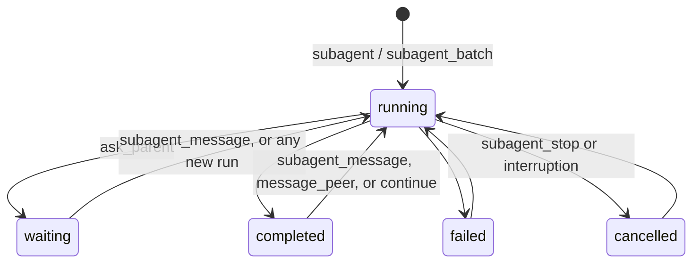

# Architecture

The plugin is a thin layer over OpenCode's own sessions. Every child is an ordinary OpenCode child session; the plugin adds tools, a record of each child, and a watcher that turns a child going idle into a message for its parent.

## Key files

- `src/index.ts`: plugin setup. Registers the tools and the bundled skill, adds the `context` hook that gives each session the right tools, and feeds server events to the coordinator.
- `src/tools.ts`: every tool. `subagent` overrides OpenCode's built-in tool of the same name.
- `src/coordinator.ts`: process-wide child records, storage, completion watchers, and report delivery.
- `src/messages.ts`: reading `session.context` messages: reports, errors, and the forked transcript.
- `src/worktree.ts`: git operations for worktree children.
- `src/capability.ts`: capability modes as session permission rules.
- `src/prompt.ts`: all model-facing text.
- `skills/smart-subagents/SKILL.md`: the bundled skill.

## How it works

### One coordinator for many plugin instances

OpenCode runs one plugin instance per location (project directory) and unloads instances that sit idle. A worktree child runs in a different location from its parent, so its tool calls execute in another instance. All instances share one server process, one event bus, and this plugin's storage, so the coordinator keeps its state on `globalThis` under a versioned symbol and mirrors each child record to plugin storage under `child/<sessionID>`.

The in-memory part holds what must be unique per process: which children have a watcher (`watching`), which a foreground call is waiting on (`foreground`), and the live instance contexts a watcher can fall back to when its own instance unloads. The stored part holds what must survive a restart: each child's parent, agent, description, status, pending question, and worktree.

### Child lifecycle

A record moves through these states:

For a background child, the tool sends the first prompt and starts a watcher. The watcher calls `session.wait`, which also follows runs that start while it waits, such as a steer. When the child goes idle, the watcher reads its outcome and newest report, sends the parent a synthetic message, and only then saves the final status. A send that fails leaves the record `running`, so the next process start sends it again.

A child that called `ask_parent` is `waiting`. Its turn ends, but the watcher sends nothing, because the question already reached the parent. The next message to the child sets it back to `running` and starts a new watcher.

A foreground call marks the child in `foreground`, waits for it directly, and returns the report as its tool result. Watchers and `ask_parent` skip foreground children, so nothing is reported twice. If the child asks a question, the call returns the question and the child becomes a background child.

Any run of a known child that the plugin did not start, such as a user typing into the child's session, raises `session.execution.started`; the event handler starts a watcher for it. Every instance receives every event, so handled event IDs are remembered for deduplication.

### Choosing tools per session

Tools register per location, so every session would see all ten. The `context` hook runs before each model request: in a child session it removes the parent tools and adds a short system note about reporting and `ask_parent`; in any other session it removes the child tools. Each tool also checks the session itself, so a stale tool list cannot bypass the split. A session counts as a child when it has a record or a `parentID`.

### Worktree children

`subagent` checks that the parent's checkout is clean, asks OpenCode to create a worktree (so it lands in the configured `worktree.directory` and in OpenCode's worktree inventory), and gives the detached worktree its own `opencode-subagent/<name>` branch. OpenCode creates a child session in its parent's location regardless of the requested location, so the plugin moves the new child into the worktree, waits for the move to apply, and checks the location before the first prompt.

`subagent_apply` works with git directly. `patch` applies every change since the starting commit, committed or not. `cherry-pick` and `merge` first commit any uncommitted work in the worktree, then try the operation in a temporary detached worktree, and touch the source checkout only when that succeeds. `discard` removes the worktree through OpenCode and deletes its branch.

## Decisions and trade-offs

- The plugin overrides the built-in `subagent` tool rather than adding a second launcher. One launch tool is clearer for the model, and keeping the built-in's name, inputs, result metadata (`sessionID`, `status`), and report metadata (`source: "subagent"`, `childID`, `agent`, `state`) keeps consumers such as `opencode-smart-compaction` working. OpenCode's own subagent plugin still appends the list of available agents to the tool description, because it finds the tool by name.
- `ask_parent` does not block. A tool call that waits for the parent would hold a child's run open across instance unloads and restarts. Ending the child's turn and waking it with the answer survives both.
- Capability modes deny only `edit` and `shell`. An allowlist of the form "deny everything, then allow reads" would also override OpenCode's built-in access to its tool-output and temporary directories, which session rules evaluate after. The cost is that MCP and plugin tools keep the agent's permissions.
- Profiles are OpenCode agents. The plugin adds no profile system of its own; agents already carry a model, permissions, and a description.

## Gotchas

- After a restart, watchers resume when the first plugin instance loads, and OpenCode loads plugins lazily per location. Until a client or session touches a project, its children are not checked.
- OpenCode does not wake a session that has pending inbox items after a restart, so a report admitted just before a shutdown appears on the parent's next run.
- `session.outcome` can still describe the previous run while a shutdown interrupts the current one, so `outcome()` in `src/coordinator.ts` checks the newest assistant message's error first.

## OpenCode internals this depends on

Recheck these on every OpenCode upgrade; paths are in the OpenCode repository.

- `packages/core/src/tool/plugin/subagent.ts`: the built-in tool's name, input fields, result metadata, and its `context` hook that appends available agents.
- `packages/core/src/session/subagent-completion.ts`: the report message format and metadata the plugin mirrors.
- `packages/core/src/plugin/host.ts`: `session.create` ignoring `location` when `parentID` is set, and which session methods the plugin context exposes.
- `packages/core/src/session/move.ts`: moves going through the inbox.
- `packages/core/src/session/run-coordinator.ts`: `awaitIdle` following successor runs.
- `packages/core/src/location-activity.ts`: the idle timeout that unloads location instances.
- The `session.execution.started` event and the `outcome` field on sessions.

## Related docs

- [README.md](../README.md): install, tools, options, and limits.
- [DEVELOPMENT.md](DEVELOPMENT.md): validation, live testing, and upgrades.